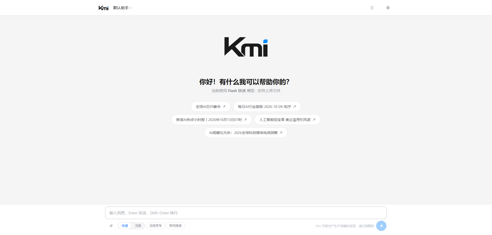

# Kmi

一个基于 DeepSeek API 的纯前端 AI 对话客户端。无需后端，密钥与对话记录全部保存在浏览器本地。

> ⚠️ 这是个人自用项目，密钥直接存放在浏览器 `localStorage` 中由前端发起请求。请勿用于多用户生产环境。

## 功能

| 功能 | 说明 |
| --- | --- |
| **双模型切换** | `deepseek-v4-flash`（快速）/ `deepseek-v4-pro`（深度），一键切换并持久化 |
| **深度思考** | 开启 `thinking` 并实时流式展示推理过程，可折叠；`reasoning_effort` 提供 Low / High / Max 三档 |
| **联网搜索** | 基于 Tavily + Function Calling，搜索结果作为独立消息注入上下文 |
| **文件上传** | 图片走 `image_url` 多模态；文本文件内联。单文件 ≤ 15MB，最多 5 个；超过 2048px 的图片自动压缩 |
| **人设切换** | 内置「默认助手」与「代码助手」两套系统提示词，左上角下拉切换，选择持久化 |
| **消息版本管理** | 重新生成时保留历史回答，可用箭头在版本间切换 |
| **问题锚点导航** | 右侧为每个提问生成一个锚点，悬浮预览问题全文，点击平滑滚动定位（需视口宽度 > 900px） |
| **对话历史持久化** | 对话自动写入 `localStorage`，刷新或重新打开不丢失上下文；超出容量时逐级降级并提示 |
| **热点推荐** | 空状态下的推荐问题会由当日热点生成，结果缓存 24 小时 |
| **Markdown 渲染** | 代码块语法高亮（highlight.js）+ 一键复制 |
| **响应式** | 600 / 480 / 360px 三档断点适配移动端 |



### 关于「前缀续写」

代码中保留了 DeepSeek Beta API 的前缀续写（`prefix: true`）能力，由 `PERSONA_PREFIX_MAP` 控制每个角色的强制开头。当前所有角色均为空字符串，即该功能处于**停用状态**。填入起始文字即可启用。

## 技术栈

- **框架**：[Vue 3](https://vuejs.org/)（`<script setup>` 组合式 API）+ [Vite](https://vite.dev/)
- **UI**：[Element Plus](https://element-plus.org/)（中文语言包）
- **Markdown**：[marked](https://marked.js.org/) + [highlight.js](https://highlightjs.org/)
- **模型接口**：DeepSeek Chat Completions API（SSE 流式）
- **搜索**：[Tavily](https://tavily.com/)

## 快速开始

```bash
npm install
npm run dev      # 开发，默认 http://localhost:3000
npm run build    # 构建到 dist/
npm run preview  # 预览构建产物
```

## 配置

### 1. DeepSeek API Key（必需）

启动后点击右上角 **设置**，填入 API Key 并保存。密钥保存在浏览器 `localStorage`（键名 `deepseek_api_key`），不会上传到任何第三方服务器。

可在 [platform.deepseek.com](https://platform.deepseek.com/api_keys) 申请。

### 2. Tavily API Key（仅联网搜索需要）

在 [tavily.com](https://tavily.com) 申请后，**通过环境变量注入，不要写进源码**：

1. 复制 `.env.example` 为 `.env.local`（`.env.local` 已被 `.gitignore` 忽略，不会被提交）
2. 填入密钥：
   ```
   VITE_TAVILY_API_KEY=tvly-xxxxxxxxxxxx
   ```
3. 重启开发服务器（`npm run dev`）—— 环境变量在启动时读取

也可以不重新构建就临时替换：在浏览器 devtools 里执行
`localStorage.setItem('tavily_api_key', 'tvly-...')`，运行时值优先于构建时注入的值。

> ⚠️ **请勿将密钥硬编码进源码后提交。** 即使之后删掉代码里的密钥，它依然留在 Git 历史记录中，必须视为已泄露并立即到服务商处吊销重发。

## 项目结构

```
.env.example                   # 环境变量模板，复制为 .env.local 使用
src/
├── main.js                    # 入口：注册 Element Plus 与全部图标
├── App.vue
├── style.css                  # 全局样式（含 Markdown 渲染样式）
└── components/
    ├── ChatView.vue           # 主组件：全部业务逻辑、模板与样式
    └── SettingsDialog.vue     # 设置弹窗（API Key、角色人设）
```

## 安全说明

- **所有 `v-html` 渲染的内容都经过 [DOMPurify](https://github.com/cure53/DOMPurify) 净化**（见 `renderMarkdown()`）。模型输出与联网搜索结果都视为不可信输入。新增渲染入口时请走 `renderMarkdown()`，不要直接注入 HTML。
- **密钥不出本机**：DeepSeek 与 Tavily 的密钥都只在前端使用，请求直连官方 API，不经过任何第三方中转。
- **密钥存放在 `localStorage` 明文**：这是纯前端方案的固有限制。请勿在公共电脑上使用，也请勿将其部署为多用户服务。

## 已知限制

- **历史记录体积上限**：受 `localStorage` 约 5MB 配额限制。超出时先剥离图片 / 附件内容，仍超出则放弃本次保存并提示。图片需改用 IndexedDB 才能跨刷新保留。
- **单组件体积**：`ChatView.vue` 承载了全部逻辑，后续扩展建议按职责拆分。

## License

未指定。如需开源授权请补充 `LICENSE` 文件。
